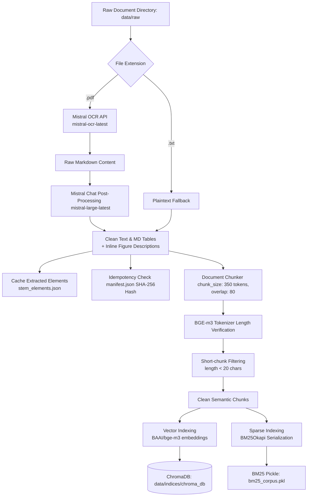
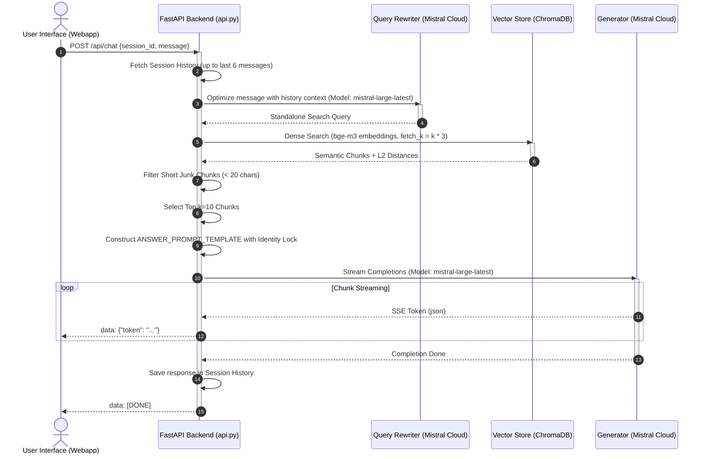
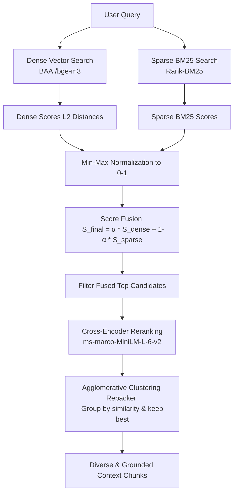

# INPPLC RAG Assistant — Project Documentation & Component Architecture

This document provides a comprehensive overview of the **INPPLC Chatbot — RAG Information Assistant**, an AI-powered retrieval-augmented generation assistant for the **Instance Nationale de la Probité, de la Prévention et de la Lutte contre la Corruption (INPPLC)** in Morocco. 

It is designed to serve as an official anti-corruption, transparency, public integrity, and probity information specialist. It processes, index, retrieves, and generates highly accurate answers from official INPPLC publications, anti-corruption laws, and report documents, strictly adhering to Moroccan anti-corruption mandates while maintaining trilingual capabilities (Arabic, French, and English).

---

## 1. System Architecture Overview

The system is divided into two primary pipelines:
1. **The Ingestion Pipeline**: Converts raw files (PDFs and TXT documents) into highly structured, clean text, captions graphics, chunks the results semantically, and stores them in dense (ChromaDB) and sparse (BM25) search indices.
2. **The Retrieval & Generation Pipeline**: Rewrites incoming queries in a history-aware context, retrieves relevant chunks from vector stores, applies security guardrails, and streams a grounded response to a web interface via Server-Sent Events (SSE).

### 1.1 Ingestion Pipeline Architecture
This offline pipeline reads files from `data/raw/`, extracts layout elements and clean text using **Mistral OCR**, caches elements locally for speed, splits the text into token-bounded semantic chunks, and populates ChromaDB and the BM25 corpus index.



### 1.2 Query & Generation Stream Flow
This online pipeline processes a user message, performs query optimization incorporating conversation history, queries ChromaDB for the closest semantic chunks, enforces domain restrictions/identity locks, and streams token-by-token responses back to the client.



### 1.3 Advanced Hybrid Retrieval & Post-Processing (Alternative Pipeline)
For evaluations and complex queries, the system includes support for an advanced hybrid retrieval flow that fuses dense embeddings search with sparse BM25, reranks the result using a cross-encoder model, and repacks chunks based on semantic diversity to prevent redundancy.



---

## 2. Directory & Component Architecture

Below is a detailed breakdown of all primary components and subfolders in the workspace.

```
inpplc-rag/
├── pyproject.toml              # Dependency configuration
├── .env                        # Private environment keys (Mistral API, HuggingFace Tokens)
├── api.py                      # FastAPI Backend server and SSE Stream router
├── scripts/                    # Command-line entry points
│   ├── run_ingestion.py        # Ingestion pipeline runner
│   ├── rebuild_embeddings.py   # Vector index builder for text files
│   ├── run_evaluation.py      # RAGAS metrics runner
│   ├── export_metrics.py       # Metrics serialization script
│   └── extract_text.py         # Local parser utility
├── src/                        # Core Application Source Code
│   ├── config/                 # centralized Settings definition
│   ├── ingestion/              # Mistral OCR, document extraction, and chunking
│   ├── retrieval/              # Embeddings, vectorstore, BM25, and fusion/repacking
│   ├── generation/             # Orchestrator, system templates, and response routing
│   ├── evaluation/             # RAGAS evaluation pipeline wrapper
│   └── utils/                  # Structlog loggers and history formatters
├── data/                       # Local Datastore (git-ignored)
│   ├── raw/                    # Raw PDFs and source texts
│   ├── processed/              # OCR cached elements and manifests
│   └── indices/                # Persistent ChromaDB collections and BM25 index
└── webapp/                     # Pure HTML/CSS/JS frontend
    ├── index.html              # Main chat layout
    ├── style.css               # Vanilla CSS layout with dark aesthetics
    └── app.js                  # Frontend state machine and SSE handler
```

### 2.1 Core Source Code (`src/`)

#### 2.1.1 Config (`src/config/`)
*   **`settings.py`**: A centralized configuration class utilizing Pydantic `BaseSettings`. It loads settings from environmental variables and `.env`. It governs key parameters including:
    *   `embedding_model_name` (defaulting to `BAAI/bge-m3` for trilingual semantic indexing).
    *   `orchestrator_model_name` (defaulting to `mistral-large-latest`).
    *   `chunk_size` (350 tokens) and `chunk_overlap` (80 tokens).
    *   `retrieval_top_k` (10 chunks) and `retrieval_min_score` (0.6 cosine similarity).
    *   Directory routes for `data/raw`, `data/processed`, and `data/indices`.

#### 2.1.2 Ingestion (`src/ingestion/`)
*   **`parser.py`**: Integrates with the **Mistral OCR API** (`mistral-ocr-latest`) to ingest PDF files. 
    1. Sends the raw file base64 payload to Mistral OCR to get markdown text.
    2. Runs the markdown output through a post-processing Chat completion (`mistral-large-latest`) with a strict prompt (`POST_PROCESS_PROMPT`). This extracts clean text, reformats tables to Markdown tables, and describes figures/schemas with a `[FIGURE:]` prefix.
    3. Handles SHA-256 hash validation against `manifest.json` to enable idempotent runs (files that haven't changed are skipped).
*   **`chunker.py`**: Splits document text into manageable pieces using a `RecursiveCharacterTextSplitter`. It utilizes the HuggingFace `AutoTokenizer` for `BAAI/bge-m3` to compute token lengths accurately. It uses specialized separators to handle multilingual sentence structures (including Arabic punctuation: `،`, `؟`, `؛`). It filters out noise chunks shorter than 20 characters.
*   **`pipeline.py`**: Coordinates the entire ingestion procedure (Parsing PDFs $\rightarrow$ Chunks $\rightarrow$ Captioning $\rightarrow$ ChromaDB persistence $\rightarrow$ BM25 Serialization).

#### 2.1.3 Retrieval (`src/retrieval/`)
*   **`embeddings.py`**: Wrapper for `SentenceTransformer` embedding models. It features lazy loading to avoid slowing down imports or backend initialization.
*   **`vectorstore.py`**: Factory for loading and creating ChromaDB vector databases using the persistent client API.
*   **`dense_retriever.py`**: Executes dense search against ChromaDB using query vectors. It returns top-k matching documents and enforces a minimum character-length filter (`MIN_CHUNK_CHARS = 20`) to eliminate OCR artefacts.
*   **`bm25_index.py`**: Implements BM25 sparse search using `rank_bm25`'s `BM25Okapi`. The index is serialized to a pickle file for fast application startup.
*   **`hybrid.py`**: Combines dense search and BM25 search. Scores are normalized via min-max scaling, then fused using:
    $$S_{\text{final}} = \alpha \cdot S_{\text{dense\_norm}} + (1 - \alpha) \cdot S_{\text{sparse\_norm}}$$
*   **`reranker.py`**: Uses a cross-encoder model (`cross-encoder/mmarco-mMiniLMv2-L12-H384-v1` or `ms-marco-MiniLM-L-6-v2`) to score query-document pairs, re-sorting candidates by relevance.
*   **`repacker.py`**: Applies Agglomerative Clustering on document embeddings to group retrieved segments by topic, keeping only the highest-scoring passage from each cluster to promote context diversity.

#### 2.1.4 Generation (`src/generation/`)
*   **`prompts.py`**: Houses prompt templates for routing and answering:
    *   `ANSWER_PROMPT_TEMPLATE`: Governs the assistant's personality. Features an **Identity Lock** (refuses to act as anything other than the INPPLC Assistant), strict **Language Constraints** (Arabic, French, or English response matching), **Domain Guardrails** (limits answers strictly to anti-corruption, transparency, governance, and whistleblowing), and **Anti-Hallucination rules** (requires direct context citation; suggestions to contact INPPLC are only permitted if the query is in-scope but context is insufficient).
    *   `CLASSIFICATION_PROMPT`: Directs the query router to identify if a query is `RAG_REQUIRED`, `DIRECT_RESPONSE` (greetings/system details), or `OUT_OF_SCOPE`.
*   **`classifier.py`**: Uses the LLM to classify user prompts for intelligent routing.
*   **`generator.py`**: Implements the `ResponseGenerator` class which routes requests to correct prompt sequences.
*   **`orchestrator.py`**: Defines the `TwoStagePipeline` class, which currently serves as a direct orchestrator invoking Mistral Large (`mistral-large-latest`) directly through the Mistral Cloud API to generate responses.

#### 2.1.5 Evaluation (`src/evaluation/`)
*   **`ragas_eval.py`**: Implements automatic quality evaluation using the RAGAS framework. It measures:
    *   **Faithfulness**: Groundedness of the answer against retrieved context.
    *   **Answer Relevance**: Match between the user question and generated response.
    *   **Context Precision**: Ranking quality of retrieved documents.

---

## 3. API & Communication Flow

### 3.1 Backend Server (`api.py`)
Exposes the backend using the **FastAPI** framework. It loads singletons lazily, serves static files from `webapp/` under the path `/app`, and provides key REST endpoints:
*   `POST /api/session`: Generates a unique UUID and initializes an empty session message history.
*   `DELETE /api/session/{session_id}`: Wipes a chat session history.
*   `GET /api/sessions`: Returns active sessions and message previews (used for sidebar updates).
*   `GET /api/session/{session_id}/history`: Returns messages recorded in a session.
*   `POST /api/chat`: Processes a user message. It calls the trilingual query rewriter, conducts dense retrieval against ChromaDB, forms the prompt layout, calls the Mistral Cloud API, and yields responses back to the client as **Server-Sent Events (SSE)**.

---

## 4. Frontend Interface (`webapp/`)

Designed as a modern, single-page chat application leveraging vanilla HTML5, CSS3, and JavaScript:
*   **Design Aesthetics**: Minimalist dark-themed interface built on modern sans-serif typography (`Inter` for English/French, `Noto Sans Arabic` for Arabic). Layout transitions are handled via subtle animations (e.g. chat bubbles fading and scaling on load, sidebar collapsing, and warning highlights).
*   **Sidebar Panel**: Houses a responsive toggle button, primary buttons for new chats and loading recent conversations, a filtered session list, and a search input for filtering session names.
*   **Topbar Controls**: Includes warning trigger (informs users to verify information with official sources), chat clear buttons, and a message content filter to highlight query matches.
*   **Chat Viewport**: Contains the main scrollable container. Displays message rows with avatar elements. Streams the response in real-time, displaying a typing indicator beforehand. Integrates markdown elements and source citation blocks cleanly.

---

## 5. Technical Parameters Summary

| Parameter | Value / Model | Purpose |
| :--- | :--- | :--- |
| **Embedding Model** | `BAAI/bge-m3` | Dense multilingual semantic vector generation ($d=1024$) |
| **Vector DB** | `ChromaDB` (Local Persistent) | Low-latency dense segment storage and similarity search |
| **Sparse Index** | `BM25Okapi` (Serialized Pickle) | Keyword-matching fallback |
| **Reranker Model** | `ms-marco-MiniLM-L-6-v2` | Cross-encoder relevance reordering (optional) |
| **Main LLM** | `mistral-large-latest` (Mistral Cloud) | Handles query rewriting and streaming generation |
| **Chunk Window** | $350$ tokens | Size of individual context pieces |
| **Overlap Window** | $80$ tokens | Boundary overlap between adjacent chunks |
| **Min Chunk Size** | $20$ characters | Safety boundary to ignore OCR fragment noise |
| **Language Target** | Arabic, French, English | Trilingual input matching |
| **Primary Domain** | Anti-Corruption & Public Probity | INPPLC operational scope limits |

---

## 6. How to Run the Project

### 1. Ingest Documents
Ensure your PDFs/TXT files are placed inside `data/raw/` and your `MISTRAL_API_KEY` is present in the `.env` file. Run the ingestion pipeline:
```bash
poetry run python -m scripts.run_ingestion
```
*(This parses files via Mistral OCR, cleans them, chunks them, and builds ChromaDB & BM25 indexes).*

### 2. Start Backend API Server
Launch the FastAPI server on port `8000`:
```bash
poetry run uvicorn api:app --host 0.0.0.0 --port 8000
```

### 3. Open Frontend Interface
Access the static application by navigating to:
```
http://localhost:8000/app/index.html
```
*(Or serve the `webapp` folder locally using a lightweight server, ensuring `API_BASE` in `webapp/app.js` matches the backend endpoint).*
